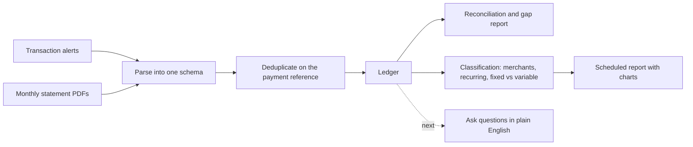

# Personal Finance Agent

A personal pipeline that turns raw bank transaction alerts and statements into one clean, deduplicated ledger, classifies the spending, and delivers a scheduled report. A natural-language query agent on top of the ledger is next.

**Status: version 1 pipeline working; query agent in development.** It is built for one user, on one machine. The source code is private because it is built around personal financial data. It is available on request with all data removed.

---

## The problem

A bank sends an alert for every transaction and a statement every month, and neither answers the questions that matter:
- What did I actually spend this month?
- Which subscriptions am I still paying for?
- Is this month unusual?

The two sources also overlap. The same payment appears once as an alert and again in the statement, and some activity appears in only one of them. Budgeting apps either want access to the bank account or need every transaction entered by hand.

## What it does

1. **Ingest** transaction alerts and password-protected statement PDFs.
2. **Parse** every alert format the bank uses into one schema. Seven message templates are covered with tested, hand-written patterns.
3. **Deduplicate** the alerts against the statements, using the unique 12-digit reference every UPI payment carries, so each payment counts once.
4. **Reconcile** the ledger against the statement and explain the gap. The residual gap came to 1.5%, and it traces to non-UPI activity that alerts can never capture. That defines the ceiling of the approach instead of over-claiming coverage.
5. **Classify** merchants, using a merchant map built through several review passes. It also detects recurring payments, splits fixed from variable spending, and sorts subscriptions into three buckets for review.
6. **Report** on a schedule, with category breakdowns compared against the user's own baseline and charts. A failed send raises an alert instead of disappearing silently.

## The design choices that matter

- **A three-tier, immutable data model:** raw message → parsed transaction → ledger transaction. The raw input is never changed, so the whole ledger can be rebuilt from scratch whenever a rule improves. A classification bug that counted investment transfers as spending was fixed retroactively this way, not patched by hand.
- **Code first, AI only for the long tail.** Deterministic parsing handles the known formats. A language model is reserved for parse fallback, merchant enrichment and, next, text-to-SQL, never the whole stream.
- **Separate the time a message was received from the time the transaction happened.** Without this, an automatic debit that posts a day later is put in the wrong period.
- **Data stays on the machine.** It is scheduled locally rather than in the cloud. After a mid-build incident in which raw records were printed where they should not have been, a strict rule was enforced: only derived metadata ever leaves the data store.

More in [docs/decisions.md](docs/decisions.md).

## Evaluation

Before the query agent is trusted, it needs a way to tell a right answer from one that only reads as right. An evaluation harness has been designed and built for it:
- a golden set of verified questions and answers;
- SQL checked by running both queries against a frozen copy of the data, not by comparing text;
- numbers checked by code, not by an AI judge;
- judge prompts calibrated against human labels with Cohen's kappa;
- a regression gate that blocks a release when any slice gets worse.

It has been tested with stand-in components and will be connected to the agent as the agent is built. Details are in [docs/evaluation.md](docs/evaluation.md).

## What's in this repository

| File | What it holds |
|---|---|
| [docs/architecture.md](docs/architecture.md) | The data model, the ingestion paths and the reconciliation method |
| [docs/decisions.md](docs/decisions.md) | The main product and technical decisions, and why |
| [docs/evaluation.md](docs/evaluation.md) | How the query agent will be evaluated |
| [docs/roadmap.md](docs/roadmap.md) | What is next, including an email-based version others could run |

## Built with

Python, SQLite, pdfplumber for statement PDFs, Plotly and matplotlib for charts, reportlab for PDF reports, Telegram for delivery, a local scheduler, the Claude API for the AI steps, and Claude Code as the build environment.
